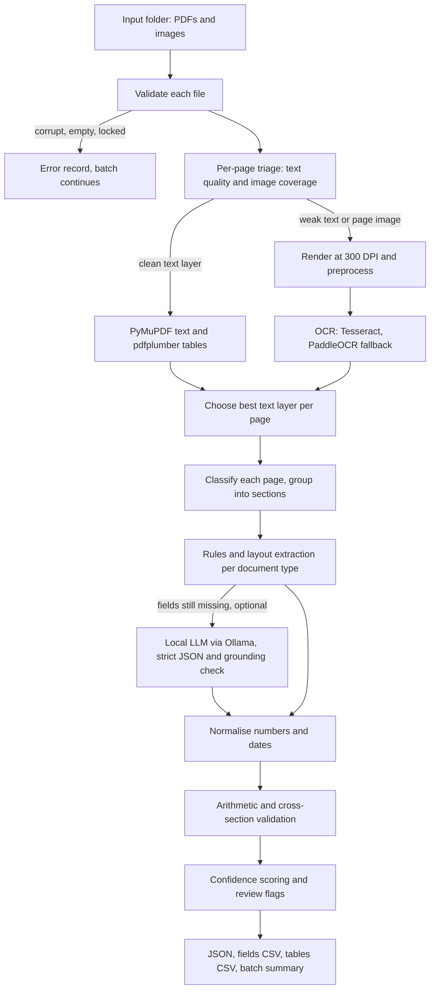

# fextract

**fextract** is a local-first Python tool that extracts structured, auditable fields from finance documents (digital PDFs, scanned PDFs and images) and writes JSON and CSV. Every value carries a confidence score, the page and text layer it came from, and a review flag when the system is unsure. It runs fully offline: no paid or hosted APIs, and small local models are optional.

Built for the *Finance Field Extraction* assignment. Repository visibility: **public**. License: **Apache 2.0**.

## Highlights

- **Document types:** commercial invoice, bank statement, balance sheet, profit and loss, cash flow statement, audit report, other notes, and `unknown`. Classification is per page, then consecutive pages are grouped into sections, so a 47-page annual report is split into its statements.
- **Digital and scanned input:** each page is triaged. A clean text layer is used directly. Weak pages are OCRed with Tesseract. When a page has both an embedded layer and OCR, the better one is chosen per page, so amounts the OCR cannot read (for example a blacked-out scan with an intact hidden text layer) are not lost.
- **Arithmetic validation:** finance documents check themselves. The tool verifies invoice line sums, balance sheet totals, profit and loss reconciliation, cash flow bridges, running bank balances and cross-statement links. A failing check lowers the confidence of the fields involved; a check with missing inputs is reported as `not_evaluable`, never as a failure.
- **Honest nulls:** a field that is absent is `null` with a reason (`not_present`, `unreadable`, `ambiguous`). Values that are inferred rather than read (for example an opening balance computed from the first transaction) are marked `derived`.
- **Batch processing:** `joblib` parallelism, and a corrupt, empty, password-protected or unsupported file becomes an error record instead of stopping the batch.

## Pipeline



Source: [docs/pipeline.mmd](docs/pipeline.mmd), rendered image: [docs/pipeline.png](docs/pipeline.png).

## Quick start

Requires Python 3.10 or newer. Tesseract is needed only for scanned or low-quality pages. Ollama is optional.

```bash
python -m venv .venv
# Windows: .venv\Scripts\Activate.ps1      macOS/Linux: source .venv/bin/activate
python -m pip install -r requirements.txt
python -m pip install -e .
fextract run --input data/samples --output results --workers 4 --format json,csv
fextract inspect results/Document2.json
```

Set `FEXTRACT_TESSERACT_CMD` if Tesseract is not on `PATH`. To use the optional local language model, start [Ollama](https://ollama.com), run `ollama pull qwen2.5:3b`, and add `--use-llm`. A local vision model can be set with `FEXTRACT_VLM_MODEL` and `--use-vlm`. Configuration is read from environment variables (see [.env.example](.env.example)); there are no credentials in the code.

The `data/samples/` folder is empty in the repository. Place your own PDFs or images there, or point `--input` at any folder.

### Output

For each input file there is a JSON file. Across the batch, `fields.csv` has one row per field with plain scalar values and empty cells for nulls; `line_items.csv` and `transactions.csv` have flat row-per-record columns; `tables.csv` contains other table types; `summary.json` has batch counts. A shortened output excerpt for a commercial invoice:

```json
{
  "source_file": "Document2.pdf",
  "page_count": 8,
  "extraction_paths": {"1": "digital_text", "2": "digital_text"},
  "sections": [{
    "doc_type": "commercial_invoice",
    "pages": [1, 2, 3, 4, 5, 6, 7, 8],
    "fields": {
      "invoice_number": {"value": "S2401-34", "confidence": 0.70, "page": 1, "bbox": null, "source": "rule", "source_layer": "digital_text", "null_reason": null, "flags": []},
      "total_sales_value": {"value": 27743.11, "confidence": 0.85, "page": 1, "bbox": null, "source": "rule", "source_layer": "digital_text", "null_reason": null, "flags": []}
    },
    "validation": [
      {"check": "line_sales_sum_equals_invoice_total", "passed": true, "status": "passed", "detail": "line_sum=27743.11, total=27743.11, items=65"}
    ]
  }],
  "needs_review": [],
  "errors": []
}
```

`source` is `rule`, `llm`, `vlm` or `derived`. `source_layer` is `digital_text` or `ocr`. Provenance is page-level; word-level bounding boxes are not populated and `bbox` is `null`.

## Implementation details and tool rationale

| Task | Tool | Why |
|---|---|---|
| PDF text, metadata, page rendering | **PyMuPDF** | Fastest text access (about 0.01 s for a full sample document) and 300 DPI rendering for OCR. |
| Digital tables | **pdfplumber** | Gives word positions and table grids; used with word geometry to assign amounts to the right column (debit, credit, balance, current year, prior year). |
| OCR | **Tesseract** (pytesseract) | Installs everywhere and returns word boxes with confidence. **PaddleOCR** is wired in as a fallback but was not installable in the test environment, so it is not benchmarked. |
| Models | **Ollama** with `qwen2.5:3b` (optional) | Fills fields the rules could not find, with temperature 0, JSON-only output and a grounding check that rejects any value not present in the source text. Off by default. |
| Output schema | **Pydantic** | Typed, validated output with confidence bounds. |
| CLI and scaling | **Click**, **joblib** | `fextract run` for batches, one isolated process per file. |

**Why not pandas or Camelot?** The output is written from typed Pydantic models, and the standard library `csv` module is enough for the two flat CSV files, so pandas was dropped as an unneeded dependency. Camelot was compared against pdfplumber and PyMuPDF (below) and gave no accuracy advantage on these documents, only lower speed.

**Why rules first, models second?** Rule-based extraction is deterministic, fast and auditable, and arithmetic validation can check its output. The language model is a fallback for missing fields only. On Document3, the only real document run with the model enabled, it promoted no additional fields after the grounding check, so the rule layer carries the results.

### Confidence and review flags

```
confidence = 0.4 * source_score + 0.3 * agreement_score + 0.3 * validation_score
```

- `source_score`: 1.0 for a clean text layer, otherwise the mean OCR word confidence.
- `agreement_score`: 1.0 when rules and the model agree, 0.5 when one source supplied the value, 0.0 when they disagree.
- `validation_score`: 1.0 when a related arithmetic check passed, 0.5 when it could not be evaluated, 0.0 when it failed.

Fields below the threshold (default 0.7, `--confidence-threshold`) are flagged `review` and listed in `needs_review`. `doc_type_confidence` is the mean classifier confidence over the strong-signal pages of a section.

### Validation checks

| Document | Checks |
|---|---|
| Invoice | line values sum to the invoice total; quantity x unit price = line value |
| Bank statement | dates in order; each balance = previous balance - debit + credit |
| Balance sheet | total assets = total liabilities |
| Profit and loss | revenue + other income - expenses + exceptional items = profit before tax; less tax = profit. Lines printed as a dash are read as nil and marked `derived` |
| Cash flow | operating + investing + financing = net change; opening + net change = closing (current and prior year) |
| Cross-section | P&L profit equals reserves movement; EPS equals profit over weighted shares; cash note equals balance sheet cash |

### Edge cases

| Input | Behaviour |
|---|---|
| Corrupt, empty or password-protected PDF | Per-file error record with a specific open/validation reason; batch continues |
| Unsupported extension, `.DS_Store` | Excluded during input discovery; not sent to document processing |
| Image file (PNG, JPG, TIFF) | OCRed as a single page; a synthetic raster invoice and cash-flow page were read by Tesseract during tests |
| Blank PDF page or all-white raster | `blank` extraction path, `unknown` section and no extracted fields |
| Non-finance document | Every section is `unknown` with no extracted fields when the whole document has no finance signal |
| Missing header information (for example a bank statement without its first page) | `null` with `not_present` and a review flag; opening and closing balances are derived from the transactions |
| Multi-page tables | Rows are stitched across pages and repeated headers are dropped |
| Tesseract or Ollama unavailable | The affected step is reported; rule output is kept |

## Results

All numbers below were measured. The sample documents are not committed because they contain real financial and personal data, so the six-document results are reported here and reproducible by anyone who supplies their own copies of similar documents.

### Real sample documents

Six sample documents were run end to end (digital and scanned PDFs, 88 pages in total). All completed with zero errors.

| Document | Content | Sections | Flagged fields | Result |
|---|---|---:|---:|---|
| Document1 | Sole-proprietor balance sheet (3 pages) | 2 | 0 | Balance sheet found, totals match (7,220,444 each side); capital schedule kept as `notes_other` |
| Document2 | Commercial invoice (8 pages) | 1 | 0 | Number, date, currency, incoterm, parties and total extracted; **65 of 65** line items; both invoice checks pass |
| Document3 | Scanned audit pack (12 pages, noisy text layer) | 4 | 13 | Audit report, balance sheet, P&L and notes found; balance sheet totals 66,980; P&L reconciles; all 3 cross-section checks pass |
| Document4 | Annual report excerpt (47 pages) | 7 | 24 | Balance sheet, P&L (both years) and cash flow (both years) extracted; statement checks pass |
| Document5 | Cash flow statement in lakhs (2 pages) | 1 | 0 | Both years extracted; all 3 checks pass |
| Document6 | Bank statement excerpt (16 pages) | 1 | 4 | **130 of 130** transactions; holder and period `null` (not on these pages); opening and closing balance derived; running balance check passes |

**Field accuracy on hand-verified fields: 64 of 64 correct.** The 64 headline fields (identifiers, dates, totals, statement line items and balances) were compared by hand against the source PDFs and are stored in `data/ground_truth/`. Names, tax numbers and addresses were deliberately left out of the labels. Run `fextract benchmark --ground-truth data/ground_truth` to reproduce this on your own copies.

> Caveat: the extraction rules were developed while looking at these six documents, so this is development-set accuracy, not an estimate for unseen documents. The synthetic benchmark provides an additional controlled robustness check on generated documents and degraded copies; it should not be interpreted as a measure of broad unseen-layout generalisation. Of the 64 correct fields, 13 were still flagged for review, so the review flag errs on the cautious side.

### Synthetic benchmark (generated documents, 216 labelled fields)

The generator (`benchmarks/generate_synthetic.py`, seed 31) produces 24 synthetic invoices and bank statements with limited variations in labels, positioning and font, plus 24 degraded image-based copies with rotation, blur, compression and reduced resolution. This is a controlled robustness check, not evidence of generalisation to unseen vendors, banks or document layouts. They are generated rather than committed: run `python benchmarks/generate_synthetic.py --count 24`.

| Run | Precision | Recall | F1 |
|---|---:|---:|---:|
| First baseline (before bank and OCR fixes) | 1.000 | 0.500 | 0.667 |
| After bank and OCR fixes | 1.000 | 0.898 | 0.946 |
| Regression introduced by OCR source arbitration | 0.934 | 0.787 | 0.854 |
| After fixing the regression | 1.000 | 0.898 | 0.946 |

The regression was traced to positioned-word party guesses overriding rule-extracted vendor names. Of 216 expected fields, 194 were matched; the 22 misses are values the OCR could not read on degraded copies, and they stay `null`. Review-flag precision is 0.146 and recall 0.636, so the flags are cautious but some wrong values still pass unflagged. Raw results: [`benchmarks/results/`](benchmarks/results).

### OCR comparison (synthetic pages, 48 pages)

| Source | Mean WER | Mean CER | Seconds per page |
|---|---:|---:|---:|
| Embedded text layer | 0.500 | 0.513 | < 0.001 |
| Tesseract | 0.058 | 0.058 | 0.639 |
| PaddleOCR | not measured | not measured | not installable in the test environment |

On the real scanned Document3, Tesseract took 1.524 s per page. Real-document error rates are not claimed because no hand-transcribed reference text was prepared.

### Table extraction tools (real sample documents)

Row recovery on Document2 (65 line items) and Document6 (130 transactions); each row is counted when it contains its expected anchor (a part number or a date). Measured on Linux, Python 3.12, 1 vCPU; reproduce with `python benchmarks/bench_tables.py`.

| Tool | Document2 rows | Document2 s | Document6 rows | Document6 s |
|---|---:|---:|---:|---:|
| pdfplumber `extract_tables` | 61 / 65 | 0.47 | 130 / 130 | 1.65 |
| PyMuPDF `find_tables` | 61 / 65 | 0.73 | 130 / 130 | 1.04 |
| Camelot lattice | 61 / 65 | 2.04 | 130 / 130 | 4.69 |
| Camelot stream | 61 / 65 | 0.25 | 130 / 130 | 0.70 |
| PyMuPDF text lines | 63 / 65 | 0.01 | 130 / 130 | 0.02 |

All tools recover the bank transactions; on the invoice the table tools find 61 of 65 rows and plain text lines find 63. Accuracy barely separates them, speed does: plain text lines are roughly 25 to 235 times faster than the table tools. The pipeline therefore starts from PyMuPDF text and word positions, uses pdfplumber for table grids and column geometry, and recovers all 65 and 130 rows after merging wrapped lines.

### Language model probe

| Model | Exact field match | Seconds | Notes |
|---|---:|---:|---|
| qwen2.5:3b | 1 / 1 | 9.07 | Single synthetic invoice probe, not a general accuracy claim |
| qwen2.5:1.5b | not run | n/a | Model not installed locally |

Peak memory was not measured. On Document3, the model added no fields beyond what the rules found after grounding checks.

### Speed

On the synthetic set, throughput was 1.73, 3.15 and 4.48 documents per second with 1, 2 and 4 workers, respectively (Windows, Python 3.14; measured values are recorded in `benchmarks/results/synthetic-pipeline-after.csv`). The 47-page annual report, which needs the most OCR work, takes the longest of the six samples.

## Testing

```bash
python -m pip install -r requirements.txt
python -m pip install -e .
pytest -q                                   # 125 tests
ruff check src tests benchmarks
black --check src tests benchmarks
python benchmarks/generate_synthetic.py --count 24
python benchmarks/bench_pipeline.py --ground-truth data/synthetic/ground_truth --output benchmarks/results/synthetic-pipeline-after.csv
python benchmarks/bench_ocr.py --samples data/synthetic/samples --ground-truth data/synthetic/ground_truth --output benchmarks/results/synthetic-ocr-after.csv
python benchmarks/bench_tables.py --samples data/samples
```

`bench_tables.py` needs the optional packages `pip install camelot-py opencv-python-headless ghostscript` for its Camelot rows; without them those rows record an error and the other tools still run.

Tests use only synthetic and fictional fixtures. The suite covers number and date normalisation, every document parser, section grouping, validation, source selection, edge cases and an end-to-end run.

## Known limitations

- Accuracy on the six real documents is development-set accuracy (see the caveat above). Unseen-layout generalisation has not been comprehensively evaluated; the synthetic benchmark covers controlled document variations only (recall 0.898).
- Field provenance is page-level; there are no word-level bounding boxes.
- Review flags are cautious (precision 0.146) and still miss some wrong values (recall 0.636).
- Document3's P&L assumes nil for lines that are absent or printed as a dash; those values are marked `derived`.
- A sole-proprietor capital schedule is reported as `notes_other`, and the long notes section of an annual report is not split by note number.
- PaddleOCR, a local vision model and peak memory use were not benchmarked.
- Bank statements are tested on one real layout plus synthetic layouts; unusual bank formats may need parser additions.

## Security and privacy

- No credentials, API keys or personal data are in the code or the repository. Configuration comes from environment variables; `.env` is git-ignored and only `.env.example` is committed.
- Sample documents and generated outputs (`data/samples/*.pdf`, `results/`, `outputs/`) are git-ignored.
- Ground-truth files contain amounts, dates and identifiers of documents only; names, tax numbers and addresses are excluded.
- All processing is local. No document text is sent to any hosted service.

## Project layout

```text
src/fextract/       CLI, pipeline, schemas, ingestion, OCR, tables, classification,
                    parsers, normalisation, validation, evaluation
tests/              Unit, regression and end-to-end tests (synthetic fixtures only)
benchmarks/         Generator, benchmark scripts and measured result CSVs
data/ground_truth/  Hand-verified labels for the six sample documents
data/samples/       Put your own input documents here (not committed)
docs/               Pipeline diagram and example output
```

## AI assistance

Developed with AI coding assistance, which the brief allows. Every reported number was produced by running the code, and the sample-document labels were checked by hand against the source PDFs.

## License

Apache License 2.0. See [LICENSE](LICENSE).
